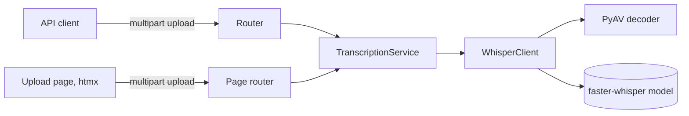

<div align="center">

# 🎙️ Media Transcription

**Upload an audio or video file, get the text back.**
A production-minded FastAPI service backed by an open-source Whisper model that runs entirely on your own machine.


</div>

---

## Contents

- [Highlights](#highlights)
- [Quick start](#quick-start)
- [Using the service](#using-the-service)
- [API reference](#api-reference)
- [Configuration](#configuration)
- [Architecture](#architecture)
- [Testing](#testing)
- [Trade-offs and assumptions](#trade-offs-and-assumptions)
- [Next steps](#next-steps)

## Highlights

- **Open-source model.** [`Systran/faster-whisper-small`](https://huggingface.co/Systran/faster-whisper-small)
  from Hugging Face, served through [faster-whisper](https://github.com/SYSTRAN/faster-whisper)
  (CTranslate2) on CPU with INT8 quantization. Swap in any compatible checkpoint with one variable.
- **Private by design.** Inference is local. Media is never sent to a third party.
- **Any common format.** wav, mp3, m4a, flac, ogg, mp4, webm and more, decoded with PyAV (FFmpeg).
  For video, the first audio track is used.
- **Hebrew and English.** Pick a language or let the model auto-detect it.
- **Hard limits that cannot be bypassed.** Upload size is capped while streaming, and duration is
  measured on the decoded audio rather than trusted from file metadata.
- **Clear failure modes.** Every error maps to a precise HTTP status with a readable message.
  Library exceptions never leak to the client.
- **Two ways to use it.** A polished web page at `/media/upload` (htmx, drag and drop, upload progress, copy and download,
  dark mode, no build step) and a documented REST API at `/docs`.
- **Tested.** Fast tests with a stubbed model, plus an opt-in test against the real model.

## Quick start

### Docker (recommended)

Requires Docker with Compose.

```bash
git clone https://github.com/Avichai96/media-transcription.git
cd media-transcription
docker compose up --build
```

The first start downloads the model (about 500 MB) into a named volume, so later starts are quick.
The container reports healthy once the model has loaded.

| URL | What it is |
| --- | --- |
| http://127.0.0.1:8000/ | Redirects to the upload page |
| http://127.0.0.1:8000/media/upload | Upload page |
| http://127.0.0.1:8000/docs | Interactive API docs |
| http://127.0.0.1:8000/health | Liveness check |

Stop with `docker compose down`. Add `-v` to also delete the cached model.

### Without Docker

Requires Python 3.13 and [uv](https://docs.astral.sh/uv/).

```bash
uv sync --locked
uv run --locked --env-file environment/local/local.config.env fastapi dev
```

## Using the service

**Web page:** open http://127.0.0.1:8000/ (it redirects to `/media/upload`), choose a file, optionally pick a language, and press *Transcribe*.

**curl:**

```bash
curl --fail-with-body \
  -F 'file=@/path/to/recording.mp3' \
  http://127.0.0.1:8000/media/transcriptions
```

```json
{ "text": "Hello and welcome to the meeting.", "language": "en" }
```

Force a language with `-F language=he` or `-F language=en`. Omit it to auto-detect.

## API reference

### `POST /media/transcriptions`

Multipart form fields:

| Field | Required | Description |
| --- | --- | --- |
| `file` | yes | Audio or video file. |
| `language` | no | `en` or `he`. Omit to auto-detect. |

Responses:

| Status | Meaning |
| --- | --- |
| `200` | Transcribed. `text` is empty when no speech was found. |
| `400` | Empty, corrupt or unreadable file, or media with no audio track. |
| `413` | File larger than the size limit. |
| `422` | Audio longer than the duration limit, or an unsupported `language`. |
| `429` | The engine is busy. Retry after the `Retry-After` seconds. |
| `503` | The model failed during inference. |

Errors share one shape: `{"detail": "Human readable message"}`.

### `GET /health`

Returns `{"status": "ok"}`. The app refuses to start if the model cannot load, so a running
server always has a model ready.

## Configuration

Settings come from environment variables only. An unset or empty variable keeps its default.
Locally they are read from [`environment/local/local.config.env`](environment/local/local.config.env),
which `compose.yaml` also loads.

| Variable | Default | Purpose |
| --- | --- | --- |
| `TRANSCRIPTION_MODEL_ID` | `Systran/faster-whisper-small` | Hugging Face model to load |
| `TRANSCRIPTION_DEVICE` | `cpu` | `cpu`, `cuda` or `auto` |
| `TRANSCRIPTION_COMPUTE_TYPE` | `int8` | CTranslate2 compute type |
| `TRANSCRIPTION_CPU_THREADS` | `4` | Threads used for inference |
| `TRANSCRIPTION_MAX_AUDIO_SECONDS` | `120` | Longest accepted audio |
| `TRANSCRIPTION_MAX_UPLOAD_MIB` | `25` | Largest accepted file |
| `TRANSCRIPTION_RETRY_AFTER_SECONDS` | `10` | `Retry-After` value sent with a `429` |
| `DEBUG` | `false` | FastAPI debug mode |
| `HF_TOKEN` | unset | Optional Hugging Face token, to avoid download rate limits |

## Architecture



| Layer | Location | Responsibility |
| --- | --- | --- |
| Router | `modules/media/transcription_service/router.py` | HTTP concerns: parsing, status codes, error mapping |
| Page router | `modules/media/upload_page_service/router.py` | Serves the htmx page and the HTML result fragment, reusing the service |
| Error mapping | `.../transcription_service/utils.py` | One `ErrorMapper` shared by both routers, so statuses never drift |
| Upload guard | `.../upload_route.py` | Rejects oversized bodies before they are parsed |
| Service | `.../service.py` | Business rules: non-empty file, size limit |
| Client | `client/whisper_client/` | Model lifecycle, decoding, duration limit, concurrency |

Design decisions:

- **Layered errors.** Each layer raises its own exception types and the layer above translates them.
  The router turns them into HTTP errors, so a library change never changes the public API.
- **Load once.** The model is loaded at startup and unloaded at shutdown through the FastAPI lifespan.
- **Never block the event loop.** Decoding and inference run in a worker thread.
- **One job at a time.** A lock guards the model. A second concurrent request fails fast with `429`
  and `Retry-After` instead of piling up behind a slow job.
- **Honest duration limit.** Audio is resampled to 16 kHz mono and counted sample by sample, and decoding
  stops the moment the limit is passed, so a file cannot understate its own length.
- **Two-stage size limit.** The `Content-Length` header is checked first, then the real byte stream is
  counted, which also covers chunked uploads with no declared length.
- **Voice activity filter.** Silence is dropped before inference, which avoids the text Whisper
  tends to invent on quiet audio.

## Testing

Fast tests, no model download:

```bash
DEBUG=false uv run --locked python -m unittest discover -s tests
```

They cover upload limits, the duration boundary, language selection, corrupt and empty files, media
without an audio track, and the busy response.

One test runs the real model on a short clip and is skipped unless you opt in:

```bash
RUN_MODEL_TESTS=1 DEBUG=false uv run --locked python -m unittest tests.test_real_model
```

Lint and format:

```bash
uv run format
```

## Golden regression set and logs

```bash
RUN_GOLDEN_TESTS=1 DEBUG=false uv run --locked python -m unittest tests.test_golden -v
```

The expanded golden set exercises six fixed recordings in both explicit and
automatic language modes, plus six silence cases. Four recordings are required
regression gates. Two known difficult recordings remain diagnostic, with visible
quality outcomes even if the suite passes.

The model revision and fixture SHA-256 hashes are pinned in
`tests/golden/manifest.json`. The report at `tests/golden/.cache/last-run.json`
includes predictions, WER, language, timing, hardware platform and package versions.
See [golden evaluation details](tests/golden/README.md) for thresholds, sources,
reproducibility and limitations. Uncached recordings and model files need internet.

Application logs use searchable event names and metadata. Model startup records
the model, device, compute type and load time. Completed transcription records
audio length, decode time, inference time, output language and whether text is
empty. Rejections record the reason. These events omit filenames and transcript
contents. The regular Uvicorn access log provides HTTP statuses.
View container output with `docker compose logs -f app`.

OpenTelemetry with the Aspire Dashboard could add request traces, system metrics and correlated logs. For this service,
custom decode and inference spans would make slow requests easier to investigate.
The current implementation uses application logs. Telemetry export remains a
separate infrastructure decision.

## Trade-offs and assumptions

These were deliberate choices to keep the scope focused. Each is a known limitation.

| Choice | Why | What production would do |
| --- | --- | --- |
| Synchronous request and response | Simplest experience for short media | Async jobs: submit, receive an id, poll or get a webhook |
| One transcription at a time, extra requests get `429` | CPU inference is heavy and this keeps latency predictable | A queue with several workers |
| 120 s audio and 25 MiB file caps | Keeps requests bounded and memory use small | Chunked decoding for long media |
| Decoded audio held in memory | Fine at these limits | Stream chunks through the model |
| Only Hebrew and English selectable | The expected use cases | Widen `TranscriptionLanguage` in `types.py`; Whisper supports many more |
| `faster-whisper-small` on CPU, INT8 | Runs on a laptop with no GPU | A larger model on GPU for better accuracy |
| Plain text output | Matches the brief | Timestamps, subtitles, speaker labels |
| No authentication, rate limiting or storage | Out of scope | API keys, per-client limits, a database for results |

Other assumptions:

- Small and Turbo were compared locally on short clips during development.
  The repeatable golden suite evaluates Small on CPU. GPU, broad speaker diversity,
  noisy recordings and long-form accuracy remain unverified.
- PyAV is pinned to 18.1.0 because the tested faster-whisper release uses an argument that PyAV 19 removed.
- The first start needs internet access to download the model from Hugging Face.
- The scaffold placeholders `model.py`, `repository.py` and `utils.py` and the `sqlmodel` dependency are
  unused. They are left over from the project template and reserved for a future database.

## Next steps

1. Job queue with persisted results and a status endpoint.
2. Timestamps and subtitle export (SRT, VTT).
3. Streaming progress for long files.
4. Metrics and structured logging for inference time and error rates.
5. GPU image and a model benchmark across sizes.

## Project layout

```
src/app/
├── main.py                      app, error handlers, health, redirect, static files
├── core/                        settings, shared HTTP errors, lifespan
├── client/whisper_client/       model, decoding and concurrency
├── modules/media/
│   ├── transcription_service/   JSON API: router, service, schemas, limits
│   └── upload_page_service/     web page: router, templates, static (htmx, app.js, app.css)
tests/                           stubbed and opt-in real-model tests
environment/                     per-environment settings
```
